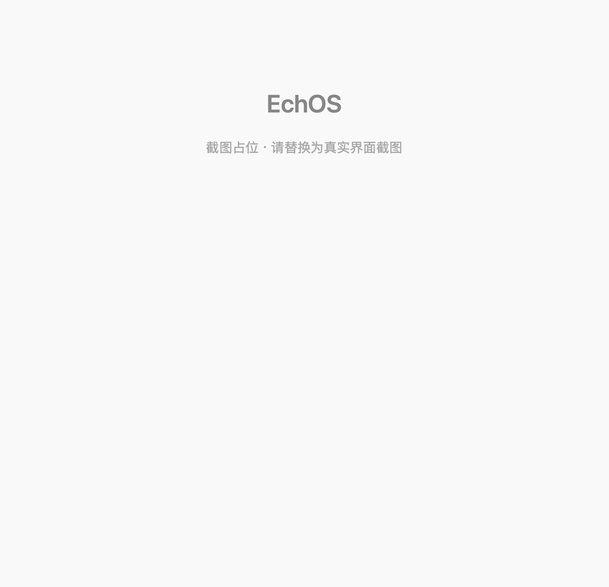

# EchOS

基于 **ECH（Encrypted Client Hello）** 的加密代理客户端，macOS 原生应用。

**Go 内核 + SwiftUI 界面**，一个 App 完成代理全部功能，不需要额外装 v2rayN / ClashX。
服务端跑在 Cloudflare Workers 上，免费额度足够个人日常使用。

---

## 界面预览



> 多服务器管理、核心配置、分流规则、运行日志都在一个窗口里。

---

## 功能特性

- **ECH 加密隧道** — 基于 TLS ECH 的代理协议，抗 DPI 检测
- **SOCKS5 + HTTP 双协议本地代理** — 自动分配端口，HTTP 端口自动 +1
- **系统代理一键接管** — 启动即接管 Safari / Chrome 等全部系统代理流量，停止时自动还原
- **三种分流模式** — 绕过中国大陆 / 黑名单 / 全局
- **自定义分流规则** — 域名、IP 段、网站分类（geosite / geoip），支持搜索与展开查看
- **多服务器管理** — 新增、重命名、删除；参数不完整时拒绝保存并弹窗说明原因
- **服务器分享**（1.0.2）— 把服务器导出成文件给其他设备，或从分享文件一键导入
- **整配置备份**（1.0.2）— 本地文件 / WebDAV 两种备份方式；WebDAV 密码存系统钥匙串，配置里只留地址、用户名和可选目录
- **连通性自检** — 启动后自动检测本地端口、国内直连、隧道连通性，结果写在日志里
- **菜单栏常驻 + 程序坞图标开关** — 适合挂后台
- **开机自启** — 登录 Mac 后自动启动
- **运行日志** — 界面日志 + 落盘文件（`logs/`，可回溯上次崩溃）

---

## 系统要求

- macOS 13.0+
- Intel 或 Apple Silicon（通用二进制）

---

## 快速开始

### 使用预打包 DMG

1. 打开 `EchOS-mac-<版本>-universal-x64.dmg`
2. 将 `EchOS.app` 拖入 `Applications`
3. 首次运行时**右键 → 打开**（无 Apple 开发者签名，Gatekeeper 会拦截）
4. 填好服务器配置 → 点「保存」→ 点「启动代理」

### 配置项

| 字段 | 说明 | 示例 |
|---|---|---|
| 服务地址 | Workers 域名（不含协议头） | `xxx.workers.dev` |
| 服务端口 | 连接端口 | `443` |
| 监听地址 | 本地代理地址 | `127.0.0.1` |
| 监听端口 | SOCKS5 端口，HTTP 自动 +1 | `30000` |
| 优选IP(域名) | Cloudflare 优选 IP，逗号分隔 | `104.16.x.x` |
| ECH域名 | ECH 公钥查询域名 | `cloudflare-ech.com` |
| DOH服务器 | ECH 公钥查询 DNS | `dns.alidns.com/dns-query` |
| TOKEN | 可选，与服务端 Workers 的 `TOKEN` 环境变量一致 | |

---

## Cloudflare 部署（服务端）

服务端是一个 Cloudflare Worker，仓库根目录的 `Worker-ECH.js` 就是完整代码。

1. 打开 [Cloudflare Dashboard](https://dash.cloudflare.com) → **Workers & Pages** → **Create** → 选 **Workers**
2. 名称随意，创建后点 **Edit code**，用 `Worker-ECH.js` 的内容覆盖默认代码，保存
3. 可选：**Settings → Variables and Secrets → Add**，加一个环境变量 `TOKEN`（值自定义，比如一长串随机字符）
   - 设了 TOKEN 后，客户端必须填相同的 TOKEN 才能连上
   - 不设 TOKEN 就是全公开，任何人都能拿你的 Worker 当代理，**强烈建议设置**
4. 部署后得到一个 `https://<你的名称>.workers.dev` 地址，填进客户端的「服务地址」

> 无需绑定域名、无需支付。Worker 免费计划每天 10 万请求，个人使用绰绰有余。

---

## 从源码构建

需要 Xcode 命令行工具（`swiftc`）和 Go 1.22+。

```bash
# 编译 App（通用二进制，Intel + Apple Silicon）
./build.sh

# 仅编译当前架构（更快）
UNIVERSAL=0 ./build.sh

# 打包 DMG
./make-dmg.sh
```

产物：`build/EchOS.app` 或 `build/EchOS-mac-<版本>-universal-x64.dmg`

---

## 项目结构

```
echos/
├── Worker-ECH.js          # Cloudflare Worker 服务端（粘贴到 Workers 里即可）
├── core/                  # Go 内核 (x-tunnel)
│   ├── x-tunnel.go        # 入口：参数解析、端口监听、隧道调度
│   ├── simple_ws.go       # WebSocket 隧道
│   ├── route_*.go         # 分流规则（geosite / geoip）
│   └── tun_*.go           # TUN 相关（macOS 未启用）
├── gui/                   # SwiftUI 界面
│   ├── Sources/
│   │   ├── App.swift           # 入口 + AppDelegate
│   │   ├── AppState.swift      # 状态管理、内核生命周期
│   │   ├── Config.swift        # 配置模型、命令行参数
│   │   ├── ContentView.swift   # 主界面
│   │   ├── ServerShare.swift   # 服务器分享文件格式
│   │   ├── ShareSheet.swift    # 分享多选弹窗
│   │   ├── WebDAVClient.swift  # 极简 WebDAV 上传/下载
│   │   ├── WebDAVSettingsView.swift # WebDAV 设置弹窗
│   │   ├── KeychainStore.swift # 钥匙串存取（WebDAV 密码）
│   │   ├── SelfCheck.swift     # 连通性自检
│   │   ├── SystemProxy.swift   # 系统代理接管
│   │   ├── StatusBar.swift     # 菜单栏控制器
│   │   ├── LoginItem.swift     # 开机自启
│   │   ├── LogFile.swift       # 日志落盘
│   │   └── ...
│   ├── Info.plist
│   └── AppIcon.icns
├── assets/                # 分流数据（geoip.dat / geosite.dat）、菜单栏图标
├── docs/screenshot.png    # 界面截图
├── build.sh               # 编译脚本
└── make-dmg.sh            # DMG 打包脚本
```

---

## 分发说明

- DMG 不含任何用户配置（配置文件在 `~/Library/Application Support/EchOS/config.json`，密码在系统钥匙串）
- 首次启动生成空白配置，不预置任何服务器
- 没有 Apple Developer ID 签名，对方首次需要**右键 → 打开**绕过 Gatekeeper
- 如要彻底消除 Gatekeeper 弹窗，需购买 Apple Developer Program 并签名

---

## 版本记录

| 版本 | 内容 |
|---|---|
| 1.0.1 | 基础版：多服务器、分流、系统代理、自检 |
| 1.0.2 | 新增服务器分享、本地/WebDAV 备份（WebDAV 目录可选）、保存结果弹窗等 |

每次 Release 的改动说明由 GitHub 根据两次发布之间的提交自动生成。

---

## 开源说明

- 本项目基于 MIT 协议开源，详见 [LICENSE](LICENSE)
- 仅供学习与个人使用，请遵守所在地区的法律法规
- ECH 是加密传输技术，本身无好坏之分；请勿用于任何非法用途
- `assets/geoip.dat`、`assets/geosite.dat` 为分流规则数据，遵循各自上游开源协议
- 本项目不提供任何可用的公共代理服务器，服务端需自行部署（见上文 Cloudflare 部署）
